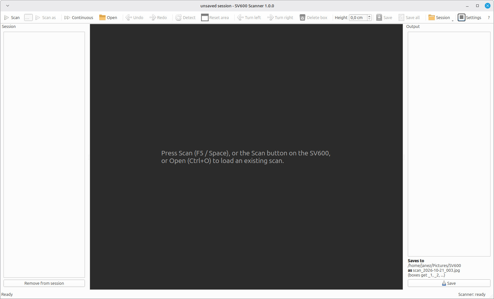
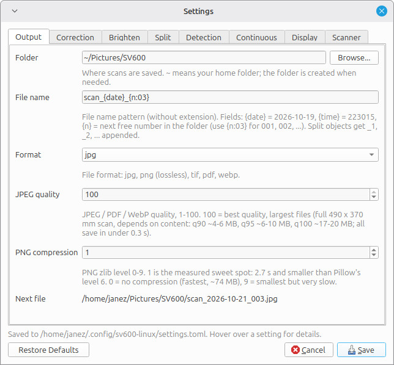

# SV600 Scanner for Linux

Scans with a Fujitsu/Ricoh **ScanSnap SV600** over USB (no SANE, no Windows), corrects the
overhead geometry, colour fringing, far-side darkening and colours (calibrated on a SpyderCHECKR 24),
and splits pages/books into
straightened images. One portable AppImage; calibration for this particular SV600 is built in.


## Run

```
chmod +x SV600_Scanner-1.0.0-x86_64.AppImage
./SV600_Scanner-1.0.0-x86_64.AppImage                 # GUI
./SV600_Scanner-1.0.0-x86_64.AppImage scan --split    # scan from the command line
./SV600_Scanner-1.0.0-x86_64.AppImage help            # all commands
```

Needs a 64-bit Intel/AMD PC with Linux from about 2022 on (glibc 2.34 or newer: Ubuntu 22.04,
Debian 12, Fedora 35, Linux Mint 21 or newer).

If the scanner is not found or "no permission" is reported, the GUI shows a one-line command
that installs a udev rule (needed once per computer on some distros).

## GUI



| Action | How |
|---|---|
| Scan | **F5** / **Space**, or the **Scan button on the SV600** |
| Scan with a name | type a prefix in the toolbar field, then **Scan as** (or Enter in the field, **Shift+F5**): files PREFIX_001.jpg, PREFIX_002.jpg, ... (numbered per prefix). Continuous mode and the scanner's button keep using the prefix until you press the plain **Scan** |
| Continuous scanning | **Ctrl+K** (toolbar *Continuous*): after each scan get ready for the next one; with a timer (Settings > Continuous) it scans by itself, otherwise press the scanner's button / Space per page; optional auto-save. **Esc** stops |
| Undo / redo | **Ctrl+Z** / **Ctrl+Shift+Z** (or Ctrl+Y): box edits, turns, deletes, work area, Detect |
| Session | every scan is listed on the left (green = saved, red = unsaved); click to go back and edit it. **Ctrl+Shift+S** saves all unsaved |
| Session files | toolbar **Session** menu: **Save session (Ctrl+E)** / Save as / **Open session (Ctrl+Shift+O)** / New / Recent. One `.sv600session` file holds every scan (lossless), its boxes, names, heights, prefix, saved state and undo history. First save encodes each scan once (~4 s per scan), later saves take a moment. ~35-40 MB per scan. Title shows `*` for unsaved session changes |
| Open an existing scan | **Ctrl+O** (raw 5572x4429 frames are corrected on load) |
| Zoom / pan | mouse wheel / drag with right or middle button, **F** = fit |
| Work area | drag the yellow dashed edges; outside is ignored by detection; remembered |
| Find objects | **D** (also runs automatically after each scan) |
| New box | drag on an empty spot |
| Move / resize / rotate box | drag inside / drag a square handle / drag the round handle (Shift = 15 deg steps) |
| Magnifier | appears while dragging a corner/edge handle, a work-area handle or drawing a box (Settings > Display) |
| Fine rotate, nudge | **[** **]** = 0.25 deg, arrow keys (Shift = bigger steps) |
| Turn output 90 deg | **R** / **Shift+R** (thick bar = edge that becomes the top) |
| Object preview | **double-click** a box or its thumbnail: the object large, exactly as saved; Rotate left/right (**R** / **Shift+R**), Previous/Next (**PgUp/PgDown**), file name field (empty = automatic name; an existing file of the same name gets _2) |
| Raised objects | **Height** box in the toolbar (applies to the selected boxes, or all boxes if none are selected, and stays as the default), or per object in the preview: **Height above desk** (e.g. 4,0 cm for a closed 4 cm book; cm, 0,1 cm steps): it is saved at true size instead of ~12 % too big. Default for new boxes: Settings > Split > Object height; command line: `scan --split --height 40` |
| Delete box | **Delete** |
| Save | **Ctrl+S**: NAME_1, NAME_2, ... per box (+ full scan if enabled); saving a scan again overwrites its own files |
| Settings | **Ctrl+,** (hover a setting for an explanation) |

The right-hand panel shows exactly what will be saved, and the next file name.

Every setting is explained in the Settings window (Ctrl+,) and in `~/.config/sv600-linux/settings.toml`:



## Files

| What | Where |
|---|---|
| Settings (commented) | `~/.config/sv600-linux/settings.toml` |
| GUI state (work area, window) | `~/.config/sv600-linux/state.json` |
| Optional calibration override | `~/.config/sv600-linux/sv600_calibration.json` |
| Correction map cache | `~/.cache/sv600-linux/` |
| Scans (default) | `~/Pictures/SV600/scan_<date>_<n>.jpg` |

## Development

```
python3 -m venv .venv && .venv/bin/pip install -e '.[calibration]'
.venv/bin/python sv600gui.py            # or sv600scan.py / sv600correct.py / sv600crop.py
tools/build_appimage.sh                 # -> dist/SV600_Scanner-<version>-x86_64.AppImage
QT_QPA_PLATFORM=offscreen .venv/bin/python tools/gui_mousetest.py dev/books/books_1.jpg /tmp/shot.png
QT_QPA_PLATFORM=offscreen .venv/bin/python tools/gui_sessiontest.py dev/books/books_1.jpg dev/desk_c.png /tmp/out
```

## Calibration

The calibration of this SV600 is built in. To calibrate another unit (printable checkerboard for
A4 and Letter, optional SpyderCHECKR 24 colour calibration): [calibration/CALIBRATION.md](calibration/CALIBRATION.md).

## Project layout

| Folder | What |
|---|---|
| `sv600/` | the app: USB protocol, correction, object detection, GUI, CLI; `data/` = bundled calibration, settings template, icon |
| `tools/` | calibration tools, checkerboard generator, AppImage build, headless GUI tests |
| `calibration/` | calibration results of this unit, the printable checkerboards and the manual for making a new one |
| `protocol/` | how the USB protocol was worked out: command table, probe, decoded USB captures |

Protocol, calibration and design notes: `NOTES.md`.

## Licence

[PolyForm Noncommercial 1.0.0](LICENSE): free to use, change and share for any non-commercial
purpose (personal use, hobby, research, education, charities, public institutions). Commercial use
is not allowed. Bundled third-party software keeps its own licences: [THIRD_PARTY_LICENSES.md](THIRD_PARTY_LICENSES.md).
